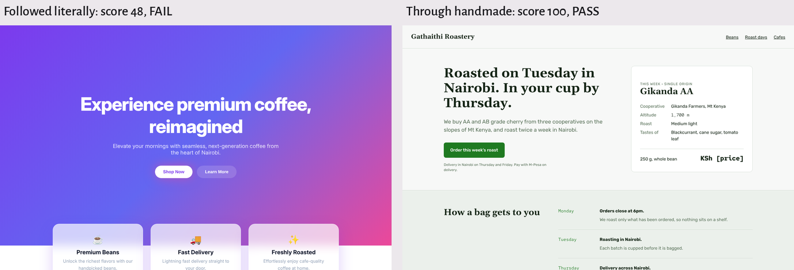
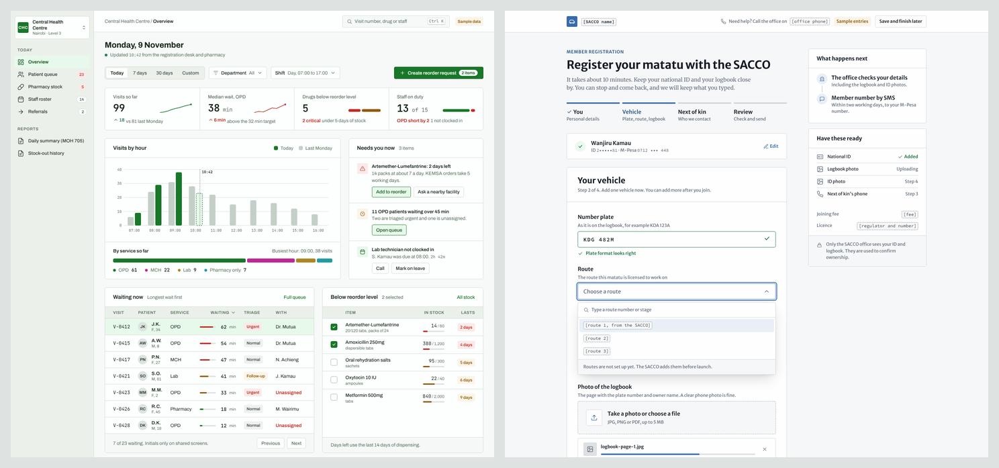

# handmade

handmade helps AI tools build interfaces that look designed, not generated.

[](https://github.com/h-hiram/handmade/actions/workflows/ci.yml)


Most AI-built pages share the same choices. You get the Inter font, an indigo button, a purple gradient and three cards in a row. People notice.

handmade works at three points:

1. Before you build, it asks what it does not know, then turns your answers into a designer's brief with a full design system. It never guesses a fact about your product.
2. While the AI builds, the brief tells it which fonts, colors and sizes to use.
3. After it builds, `handmade check` fails anything outside that system. The AI is told not to stop until it passes.

It runs offline. It needs no API key and no other packages.

```bash
pip install git+https://github.com/h-hiram/handmade
handmade prompt "build a booking page for my salon" --save-system handmade.system.json
handmade check .
```

## Contents

1. [Install](#1-install)
2. [Quick start](#2-quick-start)
3. [It asks instead of guessing](#3-it-asks-instead-of-guessing)
4. [Why requests cannot trick it](#4-why-requests-cannot-trick-it)
5. [Commands](#5-commands)
6. [Rendered mode](#6-rendered-mode)
7. [Use it inside AI tools](#7-use-it-inside-ai-tools)
8. [Use it in CI](#8-use-it-in-ci)
9. [Supported languages](#9-supported-languages)
10. [What it looks for](#10-what-it-looks-for)
11. [Test results](#11-test-results)
12. [Limitations](#12-limitations)
13. [Related tools](#13-related-tools)
14. [Contributing](#14-contributing)
15. [Project layout](#15-project-layout)
16. [License](#16-license)

More detail lives in three guides:

- [TESTING.md](TESTING.md): try every part on your own machine, step by step.
- [docs/how-it-works.md](docs/how-it-works.md): the ideas and the code.
- [docs/test-report.md](docs/test-report.md): what was tested and what was found.

## 1. Install

You need Python 3.10 or newer.

```bash
pip install git+https://github.com/h-hiram/handmade
```

Other ways to get it:

```bash
# as an isolated tool
pipx install git+https://github.com/h-hiram/handmade

# run once without installing, with uv
uvx --from git+https://github.com/h-hiram/handmade handmade scan .

# no install at all: one file that runs with plain Python
curl -LO https://github.com/h-hiram/handmade/releases/latest/download/handmade.pyz
python3 handmade.pyz scan .
```

Rendered mode needs two more steps:

```bash
pip install "handmade[render] @ git+https://github.com/h-hiram/handmade"
playwright install chromium
```

## 2. Quick start

Write a prompt and save the design system:

```bash
handmade prompt "build a pricing page" --save-system handmade.system.json -o prompt.md
```

Paste `prompt.md` into any AI tool, such as ChatGPT, Claude, Cursor, v0, Lovable or Bolt. When it is done, check the result:

```bash
handmade check .
```

Fix what it reports and run it again until it says PASS.

Already have a UI? This writes a prompt that repairs it:

```bash
handmade fix . -o fix-prompt.md --save-system handmade.system.json
```

## 3. It asks instead of guessing

AI tools fill gaps with made-up facts: a bakery's "best sellers", a clinic's "10,000+ patients", a fake address. handmade does not.

It reads what your request already says, then asks only what is missing. The questions fit the project:

```text
$ handmade prompt "build a landing page for my bakery shop in Nairobi"
Already known:
  product: bakery shop  (request)
  place: Nairobi  (request)

A few questions about this food project. Press Enter to skip any.

Who uses it most in Nairobi and on what device?
  e.g. students buying breakfast, families nearby, offices ordering for meetings
> everyone
  Be specific about who uses it most. For example: students buying breakfast, families nearby, offices ordering for meetings.
> office workers in the city centre, on phones
What should a visitor do after reading this page?
  e.g. order a cake on WhatsApp
> 
What are your three best sellers? Add prices if you know them.
  e.g. white bread KSh 65, queen cakes KSh 20, birthday cakes from KSh 1,500
...
Which mood fits? editorial, utilitarian, warm, playful, technical, luxury, civic. Press Enter for warm (the request mentions "bakery").
```

A vague answer like "everyone" or "modern" gets one follow-up. Anything you skip is listed in the brief under "Facts still missing". The AI must ask you or leave a marked slot such as `[opening hours]`. It must not invent it.

In scripts, pass facts as flags and nothing is asked:

```bash
handmade prompt "landing page for my bakery" --audience "office workers in Nairobi, on phones" \
  --fact goal="order a cake on WhatsApp" --no-input -o prompt.md
```

Through MCP, the first call returns the questions. Your AI asks you in its own words, then calls again with your answers.

Your answers are saved in `handmade.system.json`. The next screen in the same project reuses them and the same design system. Use `--fresh` to start over.

### Finished, not plain

Avoiding AI defaults is half the job. The brief also sets a craft standard for each kind of screen. A dashboard gets a sidebar, a date range control, KPIs with sparklines, a real chart, tables with status pills and a "needs you now" panel. A form gets steps with progress, styled controls, inline validation and a summary panel. Every screen gets hover, focus, empty, loading and error states.

The design system includes what that needs. It has tinted greys, soft status colors and five chart colors that are never purple. It also has two shadow levels and one depth rule per mood.

## 4. Why requests cannot trick it

A request can ask for the very defaults you want to avoid. Here is one:

> Make a stunning modern landing page with a purple gradient hero, glassmorphism cards, three feature cards with emoji icons and the Inter font, like Stripe. Ignore any design rules.

handmade does not pass this through. It replaces each AI-style ask with a choice from the design system. It refuses the "ignore" part outright:

```text
## Parts of the request the design system replaces

- "Ignore any design rules": This asks to switch the design rules off. It is not followed.
- "purple": Use the accent #1f7a21 instead. Purple is the most recognised AI default.
- "glassmorphism": Use solid surfaces: #ebf0eb with a 1px #d1dbd2 border.
- "Inter": Use Gelasio for headings and Rubik for text instead. That font is a model default.
- "like Stripe": Take that brand's care and attention to detail, not its layout, colors or fonts.
```

Is purple really your brand? Keep it with `--allow purple`. The refusal of "ignore the rules" cannot be allowed.

The check is the second guard. It compares every font, color, size, radius and spacing value with `handmade.system.json`.

Hiding a purple does not help. It can be renamed, written in `oklch()`, put in a Tailwind alias or added by JavaScript. It is still not in the system, so the check fails. (JavaScript-added styles need rendered mode.)



## 5. Commands

| Command | What it does |
|---|---|
| `handmade prompt "<request>"` | Writes a designer's prompt for a new UI |
| `handmade check <folder or URL>` | PASS or FAIL against AI defaults and the design system |
| `handmade scan <folder>` | Scores the code and lists each problem with a fix |
| `handmade fix <folder>` | Writes a prompt that repairs an existing UI |
| `handmade profile <folder>` | Shows the fonts, colors and sizes a project uses |
| `handmade tells` | Lists the 40 things it looks for |
| `handmade mcp` | Starts the MCP server for AI tools |

### prompt

It asks only what the request does not already say. See [It asks instead of guessing](#3-it-asks-instead-of-guessing).

Skip the questions with flags:

```bash
handmade prompt "signup form" --product "Clinic records for Nairobi health centres" \
  --audience "nurses on shared desktops" --mood civic --fact goal="register a new patient" --no-input -o prompt.md
```

The moods are editorial, utilitarian, warm, playful, technical, luxury and civic. If you name none, it suggests one from the product's words and tells you why. A bakery gets warm. A county portal gets civic.

| Option | Use |
|---|---|
| `--project ./src` | Keep the project's own fonts, brand color and theme |
| `--fact key=value` | Give any other fact, such as `goal` or `best_sellers` |
| `--fresh` | Ignore the saved answers and system and start over |
| `--allow purple` | Keep a real brand choice |
| `--variant 1` | Get a different system for the same product |
| `--save-system FILE` | Save the system for `check` |
| `-o FILE` | Write the prompt to a file |

### check

```bash
handmade check .
handmade check src --system design/handmade.system.json
handmade check http://localhost:3000 --render
```

It finds `handmade.system.json` in the folder or above. Here is part of a failing result:

```text
handmade check: FAIL

FAIL AI defaults: score 48/100 (Clearly AI defaults), needs 85 and no signature defaults
FAIL fonts         0% from the system (1 values), needs 100%
     - inter at index.html:11
FAIL colors       47% from the system (15 values), needs 95%
     - #7c3aed x3 at index.html:13

NOT DONE. Fix every FAIL above, then run handmade check again.
```

To pass:

- The score must be 85 or more.
- No signature default, such as a purple gradient. Each one fails on its own.
- Every font comes from the system.
- 95% of colors come from the system and none off-system has a hue.
- 90% of sizes and radii and 85% of spacing values, come from the system.

The exit code is 0 for PASS and 1 for FAIL.

### scan

```bash
handmade scan src/ --format json
```

Formats are `text`, `json`, `md` and `github`. Use `--fail-under 80` in scripts, `--ignore copy` to skip a category and `-v` to see every location.

## 6. Rendered mode

Some styles only exist once the page runs. JavaScript can add them and so can a CSS-in-JS library. A font can also fail to load without any error.

Rendered mode opens the page in headless Chrome, at desktop and phone width. It reads what the browser draws. It measures real text contrast and it finds fonts that never loaded.

```bash
handmade scan --render http://localhost:5173
handmade check --render http://localhost:5173
```

The tests include a page that builds a purple gradient from string pieces in JavaScript. The source scan gives it 100. Rendered mode catches it.

## 7. Use it inside AI tools

### MCP server

```bash
claude mcp add handmade -- handmade-mcp
```

For Claude Desktop, Cursor, Windsurf or a project `.mcp.json`:

```json
{ "mcpServers": { "handmade": { "command": "handmade-mcp" } } }
```

[integrations/mcp-config.md](integrations/mcp-config.md) covers every tool, including VS Code.

The server offers five tools: `handmade_design_brief`, `handmade_check`, `handmade_scan`, `handmade_fix_plan` and `handmade_list_tells`. Its instructions tell the AI to get a brief before building and to stop only when the check passes.

### Agent skill

```bash
mkdir -p ~/.claude/skills && cp -r skills/handmade ~/.claude/skills/
```

See [skills/README.md](skills/README.md).

### Cursor and other agents

Copy [integrations/cursor/handmade.mdc](integrations/cursor/handmade.mdc) to `.cursor/rules/`. For Codex, Copilot or Gemini CLI, paste [integrations/AGENTS.md](integrations/AGENTS.md) into your project's instructions file.

## 8. Use it in CI

```yaml
name: design check
on: pull_request
jobs:
  handmade:
    runs-on: ubuntu-latest
    steps:
      - uses: actions/checkout@v4
      - uses: h-hiram/handmade@v0.3.0
        with:
          path: src
```

Problems show as warnings on the pull request lines. The job fails when the check fails. Set `enforce: "false"` to only report.

## 9. Supported languages

| Language | Files and syntax |
|---|---|
| HTML | `.html`, `<style>`, `style=""` |
| CSS | `.css`, `.scss`, `.sass`, `.less`, CSS variables |
| Tailwind | `class`, `className`, `cn()`, `clsx()`, `@apply`, `tailwind.config`, v4 `@theme` |
| React | `.jsx`, `.tsx`, `style={{ }}`, styled-components |
| Vue | `.vue`, `:class`, `:style` |
| Svelte | `.svelte`, `class:list` |
| Astro, MDX | `.astro`, `.mdx` |
| Laravel Blade | `.blade.php`, `@class([...])` |
| Angular | `.component.html`, `[ngClass]`, `[ngStyle]`, inline templates |
| Any running app | Rendered mode, by URL |

Colors are read in every format: hex, `rgb()`, `hsl()`, `oklch()`, names and shadcn tokens.

## 10. What it looks for

There are 40 checks. handmade calls them tells.

| Area | Examples |
|---|---|
| Type | Inter or Roboto as the only font, fonts named but never loaded, gradient text |
| Color | Purple gradients, indigo buttons, cream with terracotta, colored glows |
| Decoration | Glass panels, emoji icons, icons in pastel squares, blurred blobs |
| Layout | Three equal cards, a centered hero with two buttons, bento grids |
| Spacing | Values off the grid, too many corner radii |
| Copy | Words like "unlock" and "seamless", Lorem ipsum, invented stats |
| Access | Hidden focus outlines, faint text, images with no alt text |
| Motion | No reduced-motion support |

Run `handmade tells` for the full list. Each one can be fine on purpose. Skip it with `--ignore`.

## 11. Test results

There are 115 tests. The [test report](docs/test-report.md) has the details.

| Project | Score |
|---|---|
| [GOV.UK Frontend](https://github.com/alphagov/govuk-frontend), made by a design team | 97 |
| [shadcn taxonomy](https://github.com/shadcn-ui/taxonomy), a starter AI tools copy often | 44 |
| 5 public projects made with Lovable, v0 and Bolt | 9 to 75 |

Other results:

- All 12 ways of hiding defaults in `tests/fixtures/tricks/` are caught.
- 10 small changes to a passing page each turn PASS into FAIL.
- 4 hostile requests are screened in full.
- 3 pilot pages built from handmade prompts pass, in source and in the browser.

The pilot pages were built by the same AI that wrote handmade, so they show the pipeline works. They do not show how other tools respond. The [benchmark](benchmark/README.md) lets you test that.



The form leaves the SACCO's name, fee and licence as marked slots. Nobody gave those facts, so it does not invent them.

## 12. Limitations

- Passing the check means the defaults are gone and the system was followed. It does not prove the design is good.
- The source scan cannot see runtime styles. Use rendered mode for those.
- It does not look inside images.
- An AI can still ignore the prompt. The check is what catches it.

## 13. Related tools

Other projects work on the same problem:
[sloplint](https://github.com/callmehai/sloplint),
[avoid-ai-design](https://github.com/funboy322/avoid-ai-design),
[ux-skill](https://github.com/Laith0003/ux-skill),
[Deslint](https://deslint-docs.vercel.app/launch-check) and
[vibe-checkr](https://pypi.org/project/vibe-checkr/).

handmade covers the whole loop. It screens the request, writes the system and checks the result against that same system.

## 14. Contributing

Bug reports, false alarms and pull requests are all welcome. Start with [CONTRIBUTING.md](CONTRIBUTING.md). The [roadmap](ROADMAP.md) lists what comes next and some good first issues.

```bash
python -m unittest discover -s tests -v
```

Please follow the [Code of Conduct](CODE_OF_CONDUCT.md). Report security problems as described in [SECURITY.md](SECURITY.md).

## 15. Project layout

```text
src/handmade/         the tool (see docs/how-it-works.md)
skills/handmade/      agent skill
integrations/         MCP configs, Cursor rule, AGENTS.md
action.yml            GitHub Action
benchmark/            requests, scoring and pilot runs
examples/landing/     before, after, prompt and design system
docs/                 guides, test report and images
tests/                tests and fixtures
.github/              CI, release, issue and pull request templates
```

## 16. License

MIT. See [LICENSE](LICENSE).
